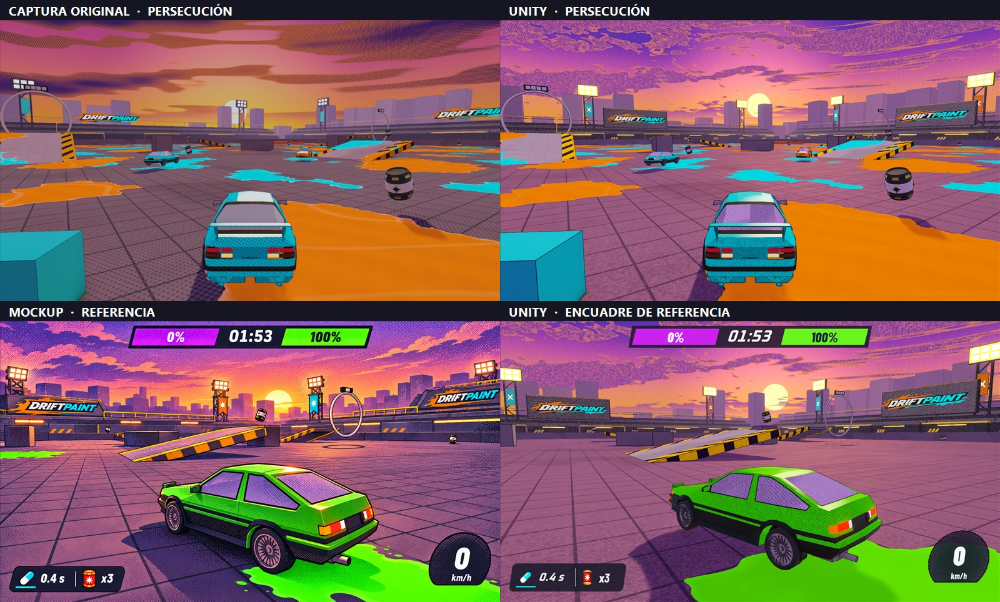
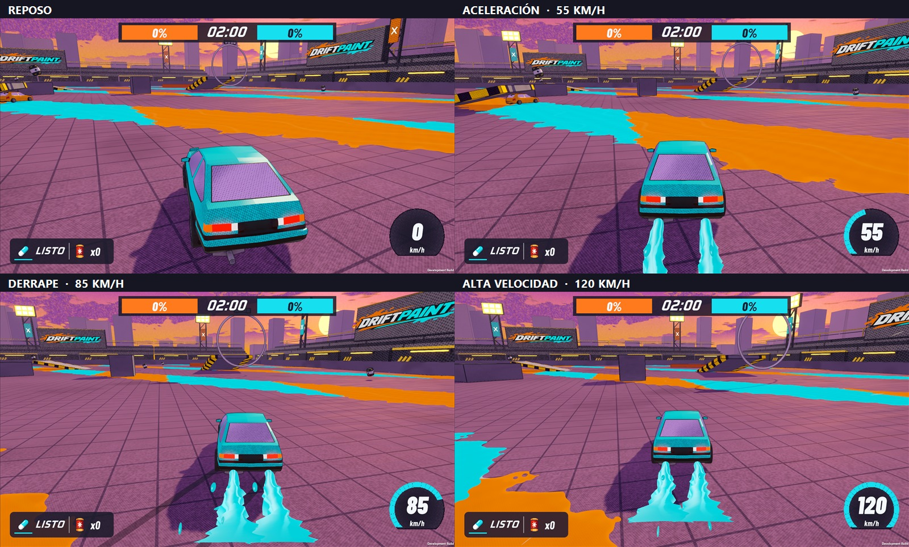

# Dirección de arte de DriftPaint

## Dónde retocar el juego

Abrí **DriftPaint → Arte → Dirección de arte**. El selector abre el inspector del recurso que usa Unity. **Mostrar en Project** selecciona el original. La ventana reúne la partida, el menú, los resultados, las dos calidades de render y los materiales compartidos.

| Si querés cambiar… | Elegí en la ventana | Primer ajuste |
| --- | --- | --- |
| El contraste entre caras iluminadas y sombras | Conducción, luz y HUD | Ajustá el ángulo, el color y la intensidad del sol. Los tres colores ambientales controlan cielo, horizonte y rebote del suelo. El sol parte de 1,6 y de una inclinación de 29°. |
| El color de un equipo | Equipos → Duplas y pigmentos | Cada equipo tiene principal, brillo y detalle. La captura verde usa la dupla verde/fucsia. El partido sigue eligiendo entre las seis duplas. |
| El acabado de los autos | Materiales → Esmalte / Vidrio | Subí «Puntos por metro» para conseguir una trama más fina. Bajá «Trama en sombra» para limpiar la superficie. «Luz de borde» actúa sobre el esmalte. |
| El carácter del cielo y del suelo | Materiales → Atardecer / Floor | En el cielo, ajustá horizonte, cenit, nubes, borde de nube y disco solar. En el suelo, ajustá el pigmento y el reflejo rasante por separado. El vector del disco solar controla su posición en el cielo. |
| El estilo y el grosor de las líneas | Line art · Pincelada sumi-e y grosores | Elegí **Pincelada** o **Continuo**. Subí el grosor del grupo que querés destacar. Los valores están en píxeles de referencia a 1080p. |
| La separación entre ruedas y suelo | Render → PC · SSAO y contorno | SSAO a media resolución, intensidad 0,48 y radio 0,28. Para comparar la silueta con el contacto, alterná por separado SSAO y Contorno a tinta. |
| El brillo de reflectores, aro y escapes | Materiales → Tribunas, Conducción, luz y HUD y Postproceso → Partida | Primero retocá la emisión de la fuente. Para la difusión global, Bloom parte de intensidad 0,20, umbral 1,20 y dispersión 0,60. |
| Los espectadores y los vitoreos | Tribunas → Público y ambiente 3D | Ajustá densidad, colores, tamaño, animación o audio en el perfil. En Play, pulsá **Aplicar público en esta partida** para probar los valores. |
| El pigmento territorial | Materiales → PinturaHumeda | Intensidad inicial de pigmento 1,16 y trama interior 0,075. Los materiales visuales reciben la textura agregada del terreno. |
| La sensación de velocidad | Conducción, luz y HUD | La curva recorre de 0 a 120 km/h. El FOV suma hasta 3,5° y el turbo agrega 1,5°. El suavizado es de 0,26 s. Las estelas arrancan por encima de 90 km/h, con máximos de 32 trazos/s en PC y 14 en Mobile. |
| El derrape y el frenado | Conducción, luz y HUD | Ajustá emisión lateral, ancho y duración de las marcas, longitud de turbo y flujo de frenado. El ancho del chorro modifica su aspecto. |
| Legibilidad de la interfaz | Conducción, luz y HUD | Editá los colores de texto y panel. El menú Arte también permite regenerar los iconos y el fondo del velocímetro. Los porcentajes mantienen el color de la dupla. |

## Cómo afinar el line art

Abrí la partida con el perfil **PC** y mirá el auto de tres cuartos, con una rampa y las tribunas detrás. La ventana edita el material compartido `M_ContornoTinta`. El perfil Mobile carece de este pase.

| Control | Qué cambia |
| --- | --- |
| Estilo de línea | **Continuo** da un borde parejo. **Pincelada** combina variación de ancho y fibras de tinta. |
| Variación de presión | Aumentala para alternar tramos gruesos y finos. En cero, el ancho es uniforme. |
| Pincel seco | Aumentalo para que asome el color del material entre las fibras. Bajalo para conseguir un trazo cargado de tinta. |
| Longitud de pincelada | Subila para espaciar los cambios de presión a lo largo del trazo. |
| Grosores por material | Carrocería y cristales parten de **3,6 px**, rampas de **3 px**, concreto de **2 px**, tribunas y ciudad de **1,8 px**. Los demás opacos, incluidas ruedas y piezas con URP Lit, parten de **2,3 px**. Cada deslizador va de **0 a 12**. En cero se apaga el trazo que dibuja ese grupo en su propia superficie. |
| Color y opacidad | Afectan todos los grupos. Para acentuar solo el auto, subí primero el grosor de carrocería. |
| Umbrales y distancia | Bajá el umbral de normales para entintar quiebres más suaves y el de profundidad para detectar saltos menores. El inicio y fin del desvanecido se expresan en metros. La opacidad lejana regula cuánta tinta llega al horizonte. |

La capa **SinContorno** excluye renderers opacos. El HUD y la pintura territorial conservan sus exclusiones. Las líneas de la grilla y los detalles pintados en las texturas se editan en sus respectivos materiales.

En la captura del techo se ve el efecto de cambiar de estilo a igual grosor y luego subir solo el grosor de la carrocería a 8 px. Se verificó cada grupo por separado en la misma toma a 1080p. [Comparación de trazos en Unity](Arte/LineArt.jpg)

En el RX-7, Unity descartaba dos polígonos autointersectados del lateral de cada modelo de rueda. Los laterales se reconstruyeron con triángulos y normales hacia afuera en los FBX izquierdo y derecho. Se revisaron las cuatro ruedas en la arena y se regeneraron las dos imágenes del selector de autos. [Antes y después del neumático](Arte/RX7-Ruedas.jpg)

## Público de las tribunas

Drift Arena y Royal Drift Road comparten el prefab `Assets/Prefabs/StadiumCrowd.prefab`, bajo **Arena → Tribunas y ciudad**. Tiene cuatro lados, cada uno con nueve módulos y cuatro filas. La primera fila apoya a 5,1 m de altura. Las siguientes suben 0,9 m y retroceden 2,3 m. Los intervalos libres dejan espacio a carteles y torres. [Detalle de los espectadores](Arte/PublicoTribunas.jpg) · [Vista desde la pista](Arte/PublicoDesdePista.jpg)

### Cómo editarlo

| Dónde | Control | Qué cambia |
| --- | --- | --- |
| Dirección de arte → Tribunas → Público y ambiente 3D | Density, Spacing | Ocupación global (55 %) y separación entre localidades (1,75 m). La densidad de cada sector multiplica la global. |
| Mismo perfil | Height, Size Variation, Seat Jitter | Altura del cuadro (1,7 m), variación de escala (10 %) y desplazamiento leve dentro de cada localidad. Pigment regula el brillo del color de la silueta. |
| Mismo perfil | Home Share | Proporción del color local, inicialmente 70 %. Las plazas se mezclan y el resto se reparte entre los otros once colores principales de TeamPalette. En los laterales, cada mitad acompaña al equipo de su cabecera. |
| Mismo perfil | Celebration Share, Fps, Tempo Variation | Probabilidad de celebrar con ambos brazos (50 %), velocidad de referencia (7 cuadros/s) y variación individual (13 %). Los ciclos tienen fases independientes. |
| Mismo perfil | Frame Pixels | Resolución por cuadro, inicialmente **256 × 256**. Después de cambiarla, usá **DriftPaint → Arte → Regenerar sprites del público**. Se generan de nuevo los círculos y trazos a esa resolución. Cada PNG contiene tres cuadros, con el mismo apoyo de los pies. |
| Mismo perfil | Cheers, Volume, Near Distance, Far Distance, Rolloff | Clips compartidos, ganancia por defecto (0,16), distancias cercana y lejana (12 y 170 m) y curva de atenuación. La curva llega a 0,055 en el extremo lejano. El control Efectos del jugador multiplica esta ganancia. |
| Prefab → cada lado → Crowd Stand | Bays, Bay Pitch, Rows, Row Step, Aisles | Cantidad y ancho de módulos, filas, separación de escalones e intervalos libres en X local. Para otro mapa, ubicá el origen en el centro de la primera fila y orientá +Z hacia las filas traseras. Left Team, Right Team y Seed permiten editar el lado y repetir la distribución. |
| Prefab → cada lado → Ambiente | Sector Volume, Source Span, Clip Index, Start Fraction | Nivel del sector, tramo de grada que actúa como emisor, clip y punto de inicio del loop. Para fijar el emisor en un punto, poné Source Span en cero. |

### Implementación y presupuesto

`CrowdStand` arma una malla de quads por lado al iniciar, después del sorteo de la dupla. `CrowdInk.shader` usa fase, velocidad y variante de cada espectador para elegir uno de tres cuadros en la GPU. `M_Publico` se comparte en ambos mapas. Las texturas importadas conservan solo el alfa, con mipmaps y filtro trilineal. El público usa profundidad de la escena, un solo pase sin iluminación y color por vértice. Los dos PNG blancos y transparentes están en `Assets/Art/Generated/Crowd`.

`CrowdAmbience` mantiene cuatro fuentes mono 3D. Cada fuente sigue el punto más próximo al listener a lo largo de su sector. Unity mezcla distancia y dirección. Los dos Vorbis de `Assets/Audio/Sfx/Crowd` se leen por streaming, con un desfase distinto por fuente. Los ajustes comunes viven en `Assets/ScriptableObjects/Crowd/StadiumCrowd.asset` y los componentes en `Assets/Scripts/Gameplay/Level`. La reproducción y el sorteo visual son locales.

En la configuración inicial hay **519 espectadores y 1.038 triángulos por mapa**. Se midieron 363 espectadores del color local. El redondeo se hace por lado y equipo. En el Development Player Windows, D3D11, RTX 4070 Laptop, a 1920 × 1080, una cámara apuntando a una grada registró 56 draw calls con público y 55 sin él. Las medianas de 180 cuadros fueron 1,334 / 0,637 ms de CPU/GPU con público, 1,263 / 0,656 ms sin público y 1,387 / 0,664 ms al reactivarlo. El número visible de lados cambia con la cámara. Las diferencias de GPU están dentro de la variación entre pasadas.

En ese Player se registraron 262.592 bytes por tira y 324.882 bytes por AudioClip en streaming. Son tamaños de los objetos informados por el Profiler, no del subsistema de audio completo. Las cuatro mallas sumaron 87.204 bytes en el Editor. Se observaron cuatro fuentes reproduciendo y un listener activo. Al aislar la tribuna norte, el canal dominante pasó de 0,00121 RMS a 71 m a 0,00736 RMS a 12 m. Girar el listener invirtió el canal dominante. Ambos clips cruzaron el fin de loop en Play. Quedan la escucha con auriculares durante combate, la comparación con dos clientes y el perfil en un dispositivo móvil físico.

## Qué había en el commit inicial

La referencia de trabajo fue el commit `c7b854f`, la captura cyan suministrada y el mockup verde. La arena ya contaba con la composición low poly, un cielo procedural, concreto entintado, trama, contorno de pantalla, pintura húmeda, chorros, derrape y volúmenes. En la vista de persecución el patrón del auto dominaba las superficies oscuras, el horizonte perdía contraste y los focos se confundían con las estructuras.

| Elemento inspeccionado | Configuración |
| --- | --- |
| Motor y render | Unity 6000.3.12f1, Universal RP 17.3.0. RenderGraph activo. PC usa Universal Renderer Forward+ con HDR en espacio lineal. Mobile usa Forward. |
| Calidad y AA | MSAA 1×. Las cámaras de partida usan SMAA Low, dithering y postproceso. Dos cascadas para la luz principal en PC, mapa 2048 y alcance 45 m. Mobile usa una cascada y mapa 1024. |
| Renderer Features | PC ya tenía SSAO y contorno por profundidad y normales. El contorno toma el color antes de los transparentes. Mobile conserva su renderer ligero. |
| Volúmenes | Perfil global de partida y perfil de resultados de mayor prioridad cuando se muestra esa pantalla. El menú tiene otro perfil. La cámara de partida toma el volumen de escena. |
| Luz y reflejos | Una direccional con sombras suaves, ambiente de tres colores y reflejo ambiental por defecto. No se agregó un horneado de luz ni probes por auto. Las tribunas decorativas tienen sombreado en el material. |
| Autos, pintura y VFX | Los slots de los FBX identifican carrocería y capó. Los colores de equipo llegan por bloque de propiedades. Pintura sobre piso y rampas a partir de una textura común. Ya existían escape, salpicadura, estela de proyectil y marcas. |
| Cámara y diagnóstico | Seguimiento propio con CarCameraRig, paneo, mirada atrás y colisión. Sin Cinemachine. Windows Standalone usa PC. Existen perfiles Mobile para otros destinos. Se usaron Unity Test Framework, un Development Player, FrameTimingManager, ProfilerRecorder y contadores de D3D11. |

La grilla de celdas de un metro, la autoridad de las conquistas, el puntaje y la sincronización siguen siendo los sistemas de la partida. Los umbrales visuales de velocidad se eligieron con las definiciones de conducción y pintura. [Art Bible](https://docs.google.com/document/d/1EDlJLcY-Lo2NJxMWEeWaokQvgvvsNZecVUQ3AvMpbWw/edit) · [GDD](https://docs.google.com/document/d/1RPoAgK_j26gDn8of1Xim0W3yjyA-eCgoIzUntmcwiu8/edit)

## Cambios y verificación por fase

| Fase | Cambio en el proyecto | Comprobación y alcance |
| --- | --- | --- |
| 1 · Luz | ArenaLighting y DrivingArt aplican sol cálido y ambiente violeta en ambas arenas. VP_Gameplay usa Neutral, contraste +13 y saturación +9. | Captura con trama, Bloom, SSAO y contorno apagados para revisar los planos de la carrocería, la rampa y su sombra. |
| 2 · Vehículos | InkConcrete distingue esmalte y vidrio. CarTeamColor conserva identidad de slots, texturas y colores de equipo. Los neumáticos, faros y partes mecánicas conservan los materiales propios de cada modelo. | AE86 verde a tres cuartos, toma de persecución con RX7 y rivales en escena. El vidrio del AE86 se asigna al slot Material.005. |
| 3 · Contornos | InkOutline usa el grosor cercano, profundidad y normales. El pase respeta el bit de stencil escrito por pintura y por la capa de exclusión. El cielo conserva su propio pigmento. | Cartelería y texto fuera de la detección. Se comparó el pase de PC encendido y apagado y se revisó la silueta en movimiento. |
| 4 · Halftone | InkCommon concentra puntos en sombra, varía su radio y filtra con derivadas. El patrón se ancla al mundo en arquitectura, al auto en carrocería y a la dirección de vista en el cielo. | Comparación de materiales y capturas móviles de SMAA y TAA en PC. El HUD usa sprites impresos y tipografía sobre el render de la escena. |
| 5 · Ink Wash | Sunset separa horizonte, disco, dos escalas de pincelada, pigmento y trama. ArenaColors y el perímetro aportan siluetas y bruma. | Revisión del horizonte junto al aro y las torres. La silueta de las nubes sigue siendo procedural. |
| 6 · SSAO | Se calibró la feature nativa de PC para un contacto de corto alcance. | Comparación individual en la medición de GPU y revisión visual bajo ruedas y rampa. La pintura recibe una contribución acotada. |
| 7 · Bloom | Ajustes de VP_Gameplay, lámparas HDR, pantalla del aro según carga y escape según aceleración/turbo. | Comparación con Bloom apagado. La selección depende de luminancia. El HUD se compone después. El proyectil conserva su estela y pigmento de equipo. |
| 8 · Territorio | WetPaint conserva el borde orgánico y la textura agregada. Añade pigmento, trama tenue y exclusión del contorno en los fragmentos visibles. | Piso neutral entre dos colores y pintura sobre rampas. Pruebas existentes de grilla, rasterización, paletas y codificación. |
| 9 · Conducción | CarCameraRig, CameraSpeedLines y CarPaintEffects leen velocidad, acelerador, freno, drift, turbo y contacto. La cámara se desplaza ligeramente a tres cuartos en reposo y se centra antes de alta velocidad. | Sandbox en Play Mode con estados controlados. Marcas activas en drift con contacto y apagadas en salto. Al frenar, quedar aturdido o teletransportarse, la cámara recupera el encuadre. |
| 10 · Arena y HUD | Señalización, bandas de seguridad, reflectores y ciudad en la malla de perímetro compartida. Cristales, focos, iconos y velocímetro revisados. | Capturas fijas de las dos arenas y prueba del Player a 1080p. La vista verde usa un encuadre de referencia. La vista cyan usa la cámara de conducción. |

**Repetir las capturas.** Usá **DriftPaint → Arte → Capturas de referencia**. Genera siete PNG a 1920 × 1080 en `Captures/editor`. Prepara los autos, dos equipos y pintura temporal en los mapas reales. La toma verde usa el AE86, un reloj y un marcador fijados para comparar arte. Al terminar se restaura la configuración de escenas. El Sandbox permite comparar conducción y el menú de arte permite alternar los efectos en PC.

**Alcance de las escenas.** Los cambios persistentes en Match_DriftArena y Match_RoyalDriftRoad son los vínculos de iluminación, carteles y sus capas. Comparten perfiles, paleta y malla de fondo. Para volver al arte anterior en control de versiones, revisá juntos escenas, renderer, capa, materiales, constructores y sus assets generados. Las ediciones locales previas de fuentes y calidad de PC deben conservarse por separado.

## Comparación visual

La fila superior compara la captura cyan suministrada con Unity en persecución. La inferior compara el mockup con el encuadre de referencia. En las iteraciones se redujo la escala aparente de los puntos, se alinearon rampa, aro, sol y señalización y se ajustó la separación entre asfalto y auto. Las diferencias más visibles son el dibujo de las nubes, el reflejo cálido del piso, las ruedas y las salpicaduras pequeñas. [Render de Unity a 1920 × 1080](Arte/DriftArena.png)

En las tomas verdes, el error absoluto RGB medio frente al mockup pasó de 27,7 a 24,7 sobre 255 al remuestrear las imágenes a 96 × 54. Bajo la fórmula `1 − error / 255`, eso equivale al 89,1 % y al 90,3 %. Este indicador sigue grandes masas de color y composición. Apenas registra la calidad del trazo fino. Un objetivo artístico del 90 % sigue requiriendo revisión visual.

La segunda lámina muestra un recorrido controlado del Development Player. Los autos, shaders, VFX y HUD son los del juego. El banco fija las entradas y mueve el vehículo de forma reproducible para comparar estados. En el Sandbox, con FOV base 60°, la prueba registró 60° en reposo, 60,91° a 40 km/h, 62,95° a 90, 63,50° a 120 y 65° con turbo. El frenado volvió a 60°. Hubo seis o siete partículas periféricas a velocidad máxima y cero a 90 km/h o menos. Se comparó SMAA Low con TAA en el mismo recorrido a 120 km/h. SMAA conservó mejor el detalle del vidrio y quedó activo.

## Pruebas funcionales

Pasaron 112 pruebas en la copia aislada del proyecto. Fueron 110 pruebas del repositorio y dos integraciones instrumentadas. La primera ejercitó el Sandbox con estados controlados de conducción. La segunda abrió Match_DriftArena, esperó la cuenta regresiva, aceleró el auto local con sus físicas normales y comprobó la grilla de la partida. En 2,5 segundos recorrió 23,90 m, alcanzó 68,3 km/h y confirmó 50 celdas. El control de iluminación permite revisar el auto y la rampa con las cuatro capas de efectos desactivadas. [Captura de iluminación](Arte/Iluminacion.jpg)

## Rendimiento observado

Development Player de Windows, D3D11, RTX 4070 Laptop, 1920 × 1080, VSync desactivado. El banco usó tres autos, la arena y pintura de dos equipos, HUD y efectos activos a velocidad alta. La pose se mantuvo fija durante la medición. Se descartaron 60 cuadros de calentamiento y se tomó la mediana de los 150 siguientes por configuración. El recorrido con movimiento se capturó después. Valores de la corrida `ArtPublicacionPlayer`.

| Configuración | GPU, ms | CPU, ms | Draw calls |
| --- | ---: | ---: | ---: |
| Todo | 0,839 | 1,532 | 424 |
| Sin contorno ni máscara | 0,717 | 1,402 | 420 |
| Sin SSAO | 0,684 | 1,449 | 421 |
| Sin Bloom | 0,899 | 1,519 | 418 |
| Intensidad de trama en cero | 0,813 | 1,477 | 418 |
| Sin partículas de conducción | 0,825 | 1,495 | 412 |
| Base con todos los ajustes anteriores combinados | 0,625 | 1,466 | 292 |
| Todo, repetición al final | 0,813 | 1,592 | 418 |

**Lectura**. Las medianas de las dos series con todos los efectos activos estuvieron entre 282.878 y 283.970 triángulos. Apagar SSAO y contorno por separado produjo la reducción de GPU más clara. La corrida sin Bloom quedó por encima de la completa, así que esta muestra no permite asignar un ahorro preciso a Bloom. Anular la intensidad de trama conserva instrucciones del shader. Los deltas de la tabla incluyen variación de relojes, estado de partículas y orden de ejecución.

**Transparencias y overdraw**. Los contadores `D3D11_QUERY_PIPELINE_STATISTICS` registraron 20,58 millones de invocaciones de pixel shader por cuadro completo, incluidos prepasos y postproceso. El intervalo entre el evento 449 y el fin de transparentes incluye el fullscreen de contorno. Con ese pase y su máscara apagados se registraron 51.105 invocaciones en ese intervalo, unas 0,025 por píxel de salida en esta cámara. Es una medida de trabajo de fragmentos. El total del cuadro incluye superficies intermedias de otras resoluciones.

En una segunda ejecución con la dupla fijada para las capturas, el cuadro completo dio 0,997 ms de GPU y 1,788 ms de CPU al inicio, y 0,830 ms de GPU y 1,608 ms de CPU al repetir. El perfil corresponde a una GPU dedicada en una escena controlada. Quedan por medir un dispositivo Mobile físico, GPU integrada y una partida en red con varios clientes. La cámara, los límites de partículas y el renderer Mobile se pueden ajustar desde la ventana de arte.

## Referencias de implementación

Se reutilizaron los shaders y renderer de DriftPaint. OutlineFx ofrece contorno en URP y tiene licencia MIT. El proyecto de Daniel Ilett muestra el enfoque fullscreen de Unity 2022 y también usa MIT. El renderer existente ya disponía de profundidad, normales y un punto de inyección adecuado. [OutlineFx](https://github.com/NullTale/OutlineFx) · [Fullscreen Outlines](https://github.com/daniel-ilett/shaders-fullscreen-outlines)

Stylized Rendering usa RenderGraph en Unity 6 y licencia CC BY 4.0. Para mantener distinta densidad por material se optó por la función compartida de HLSL. El ejemplo MIT de Cyanilux fue creado con URP 8.2. KinoAqua ofrece postproceso de acuarela para URP/HDRP bajo Unlicense. Las nubes y el pigmento ambiental quedaron integrados a sus materiales. No se añadieron paquetes externos. [Stylized Rendering](https://github.com/cannoli-cat/stylized-rendering) · [URP Watercolour Shaders](https://github.com/Cyanilux/URP_WatercolourShaders) · [KinoAqua](https://github.com/keijiro/KinoAqua)
