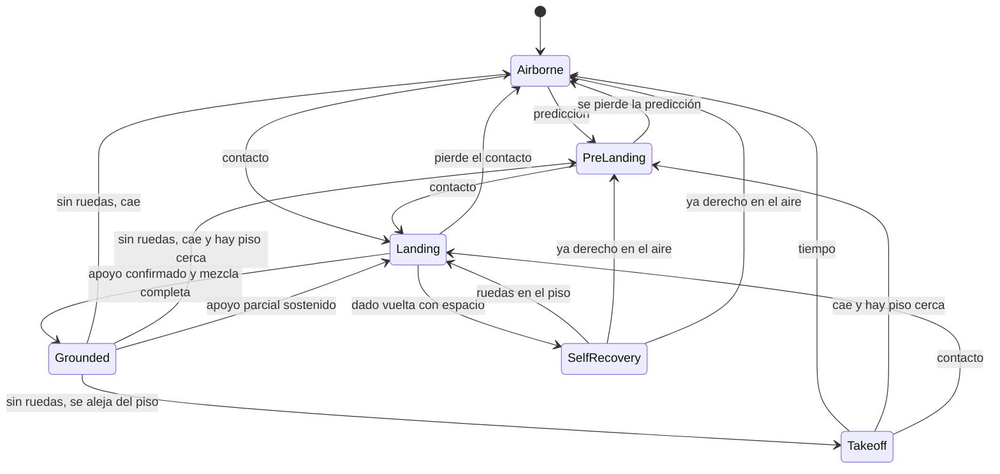

# Estabilidad y aterrizaje del auto

Cómo se sostiene el auto en el piso, cómo vuela, cómo aterriza y cómo se recupera. Solo se simula el auto local; los remotos son cinemáticos y siguen la pose de red.

## Un paso de física

`CarController.Simulate` es el único orden de ejecución:

1. `CarGroundSensor.Sense` lee ruedas, casco y predicción. No aplica nada. Hace 7 consultas como máximo.
2. `CarStabilityController.Evaluate` pasa la lectura por `VehicleStabilityFSM` y obtiene un `StabilityFrame`: estado, permisos y mezcla de manejo.
3. `ApplyAssistForces` aplica todas las fuerzas de estabilidad. Es el único que lo hace.
4. `CarMotorLocomotion` aplica motor, dirección y agarre según `DriveBlend`.

Regla para sumar cosas: una fuerza nueva de estabilidad va en `CarStabilityController` y se habilita con un permiso del frame. Hay una sola adherencia (gana la mayor) y una sola corrección de inclinación por paso.

## Estados



- El vuelco cuenta 1,5 s de contacto. Un rebote de hasta 0,12 s sobre el techo no reinicia la cuenta.
- Sin espacio para girar, o durante la espera entre intentos, titila 1,5 s y se reubica.
- La recuperación activa dura como mucho 1 s. Si no alcanza, se reubica.
- Cerca de un vuelco completo el auto rueda sobre su largo: por cabeceo la trompa hace palanca contra el piso.
- Un auto casi quieto apoyado a medias cuenta como varado y pide ayuda igual que uno dado vuelta.

## Configuración

- Valores por modelo: bloque **Stability** de cada `CarData_*.asset`. Hoy los cinco modelos usan los mismos.
- Rangos, tipos y unidades: `StabilitySchema` (`Scripts/LiveOps/StabilityOverrides.cs`). Es la única definición y la usan la lectura remota, la copia de la sala y la validación de las fichas.
- Remoto: objeto `stability` dentro de cada auto de `car_stats`. La clave es el nombre del prefab (`Car_RX7`).
- Cada campo se valida por separado: uno inválido se descarta con aviso y los demás se aplican. Los grupos que dependen entre sí (ángulos, giros y adherencia) vuelven juntos a la ficha si quedan incoherentes.
- `landingBounciness` no es remoto: el casco usa un solo material para piso, paredes y autos, y cambiarlo tocaría los tres.
- Todos los clientes usan la configuración copiada en la propiedad `cfg` de la sala, así que un cambio remoto no afecta partidas en curso.

### Probar en dv y promover

1. En Remote Config, environment **dv**, sumar los campos de [car_stats.dv.ejemplo.json](car_stats.dv.ejemplo.json) al valor actual de `car_stats`, sin borrar los que ya estén.
2. Abrir el Editor o un build de desarrollo, entrar a una sala nueva y revisar en la consola que `[LiveOps]` no informe valores descartados.
3. Comparar con F7 (panel) y F8 (exportar) en `Sandbox_Car`.
4. Cuando el equipo lo apruebe, copiar el mismo valor al environment **production**.
5. Para volver atrás, borrar el objeto `stability`: cada campo vuelve a la ficha del auto.

### Tamaño de la propiedad cfg

| Caso | Bytes |
|---|---|
| Sin cambios | 43 |
| Cinco autos con todos los campos | 8821 |
| Peor caso aceptado (12 autos, curvas de 8 puntos) | 23857 |

El máximo de una cadena en PUN es 32767 bytes.

## Decisiones

| Decisión | Motivo |
|---|---|
| `flightGravity` = 10 m/s² en el aire | Antes el auto llevaba esa gravedad extra siempre. Sin ella el alcance de las rampas crece mucho (ver tabla) y se sale de los aros y las arenas. Es vertical y por el centro de masa, así que no gira el auto. Con 0 queda solo la gravedad del proyecto. |
| Topes de suspensión sin rebote | El resorte solo no frena una rueda que entra rápido en una rampa o en una caída fuerte, y el casco golpeaba el piso. |
| `maxSuspensionAcceleration` = 120 m/s² por rueda | Acota el empuje de una rueda muy hundida. |
| Centro de masa e inercia sin cambios | Se alcanzaron las metas sin tocarlos. |
| Paso de física de 0,02 s | A 60, 100 y 120 Hz el resultado cumple igual: no hay beneficio que pague el costo. |

## Mediciones

Unity 6000.3.12f1, editor sin gráficos. 90 aterrizajes normales por corrida: 18 casos por 5 autos. Los CSV completos están en esta carpeta.

Las tablas y los CSV son con `suspensionDamping` 7, `suspensionRebound` 2,5 y `landingReboundDamping` 0,35. Los valores actuales son 5, 1,8 y 0,2, para que se note más el peso al caer.

| | Meta | Antes | Ahora |
|---|---|---|---|
| Casos fuera de meta, 50 Hz | 0 | 60 de 90 | 0 de 90 |
| Casos fuera de meta, 60 / 100 / 120 Hz | 0 | 65 / 74 / 71 | 0 / 0 / 0 |
| Rebote máximo | 0,15 m | 7,23 m | 0,008 m |
| Retención tangencial mínima | 90 % | 84 % | 97,3 % |
| Tiempo máximo hasta manejar | 0,300 s | 2,44 s, y 16 casos nunca | 0,180 s |
| Restitución máxima | 0,05 a 0,15 de referencia | 1,55 | 0,080 |
| Inclinación final máxima | — | 180° | 0° |

| Auto a 50 Hz | Rebote máx. antes → ahora | Restitución máx. | Retención mín. | Tiempo a manejar máx. | Nunca manejó | Fuera de meta |
|---|---|---|---|---|---|---|
| AE86 | 4,903 → 0,007 | 1,069 → 0,072 | 0,944 → 0,973 | 1,02 → 0,18 | 4 → 0 | 12 → 0 |
| A_R7 | 6,650 → 0,007 | 1,438 → 0,059 | 0,841 → 0,973 | 1,68 → 0,18 | 3 → 0 | 12 → 0 |
| CC96 | 7,227 → 0,008 | 1,554 → 0,080 | 0,841 → 0,973 | 1,78 → 0,18 | 6 → 0 | 12 → 0 |
| Gc14 | 4,396 → 0,007 | 1,013 → 0,065 | 0,916 → 0,973 | 1,32 → 0,18 | 2 → 0 | 12 → 0 |
| RX7 | 3,059 → 0,007 | 0,864 → 0,075 | 0,856 → 0,973 | 2,44 → 0,18 | 1 → 0 | 12 → 0 |

Alcance de los saltos del RX7 (m), con la gravedad de vuelo y sin ella:

| Caso | Antes | Con 10 m/s² | Con 0 |
|---|---|---|---|
| Rampa 14°, 12 m/s | 13,8 | 14,0 | 20,4 |
| Rampa 14°, 20 m/s | 19,5 | 19,2 | 30,1 |
| Rampa 14°, 28 m/s | 18,1 | 27,8 | 45,6 |
| Rampa 14°, 33 m/s | 30,8 | 33,0 | 55,4 |
| Rampa 20°, 28 m/s | 27,5 | 32,1 | 55,9 |

Escenas reales (todas las rampas, 5 autos, 15, 22 y 30 m/s):

| Escena | Terminan derechos | Reubicaciones | Cruces de aro |
|---|---|---|---|
| Sandbox_Car | 17 → 45 de 45 | 25 → 0 entre las tres | 0 → 0 |
| Match_DriftArena | 30 → 60 de 60 | | 30 → 30 |
| Match_RoyalDriftRoad | 38 → 60 de 60 | | 30 → 30 |

Los mismos saltos que antes cruzaban un aro lo siguen cruzando. Los valores de `rebound_m` de hasta 0,26 m en `arenas_final.csv` son contra el muro perimetral, a 62 m del centro, y no del aterrizaje: antes del muro el máximo es 0.

Locomoción: 0 a 120 en 5,80 s, frenado en 1,88 s, marcha atrás a 40 en 2,76 s, velocidad máxima 121,6 km/h y giro y derrape idénticos antes y después. Cambia solo la entrada a rampa: perdía de 2,9 % a 3,8 % de velocidad y ahora gana cerca de 1 %.

Costo: unos 7,8 µs por paso y por auto en el Editor, sin asignaciones de memoria.

## Repetir las mediciones

Con el Editor cerrado, desde la raíz del proyecto:

```powershell
& "C:\Program Files\Unity\Hub\Editor\6000.3.12f1\Editor\Unity.exe" -batchmode -nographics -projectPath . -runTests -testPlatform PlayMode -testFilter VehicleStabilityPlayTests -testResults Logs\playmode.xml -logFile Logs\playmode.log
```

`VehicleLabReport` y `VehicleArenaReport` son explícitos: se eligen con `-testFilter` y escriben CSV en la carpeta de la variable `DRIFTPAINT_LAB_OUT`. `DRIFTPAINT_LAB_DT` cambia el paso de física, `DRIFTPAINT_LAB_MODELS` elige autos y `DRIFTPAINT_LAB_CFG` aplica una configuración de sala.

## Sin verificar

- Dos clientes de Photon, simulador de lag, migración de Master y reconexión en vuelo.
- Build en dispositivos y costo fuera del Editor.
- Sensación de manejo, sonido y sacudida de cámara con una persona jugando.
